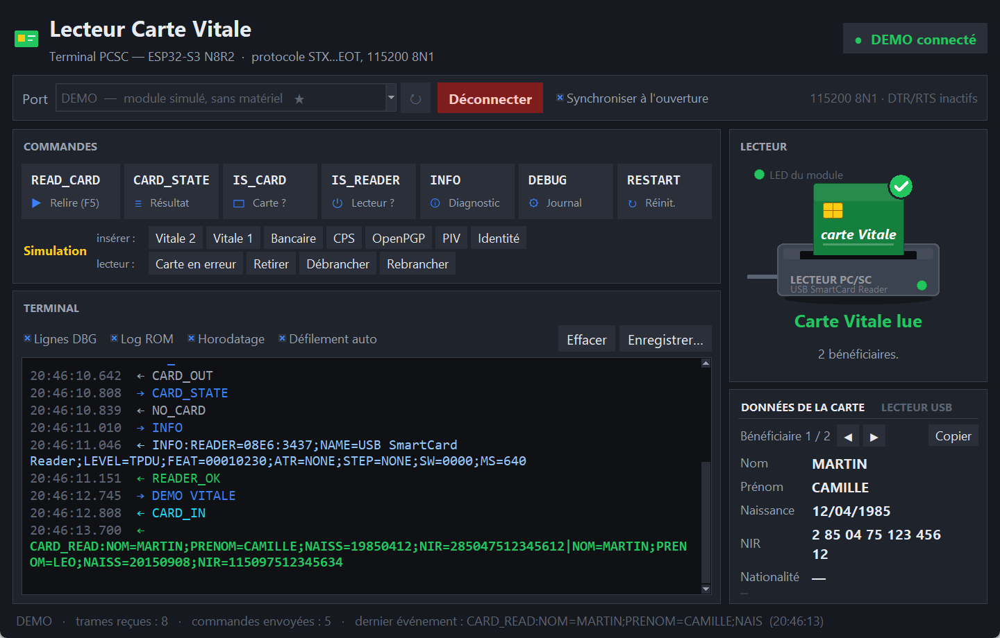
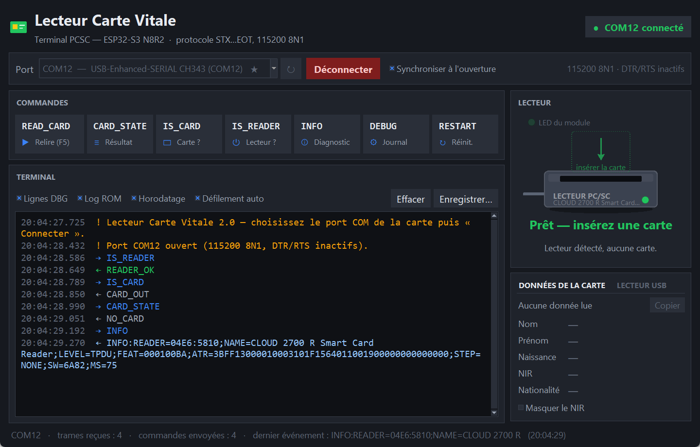
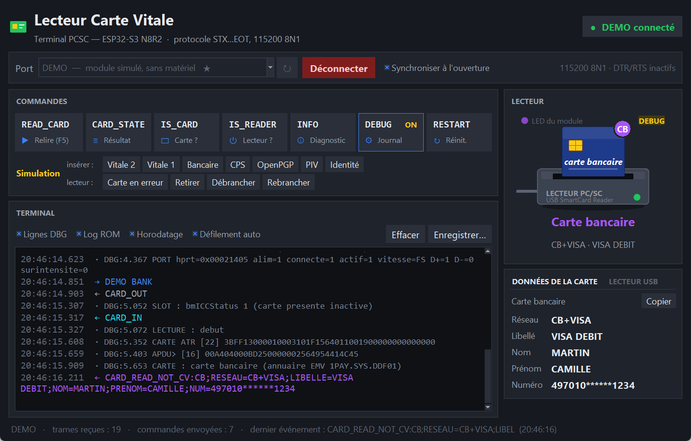
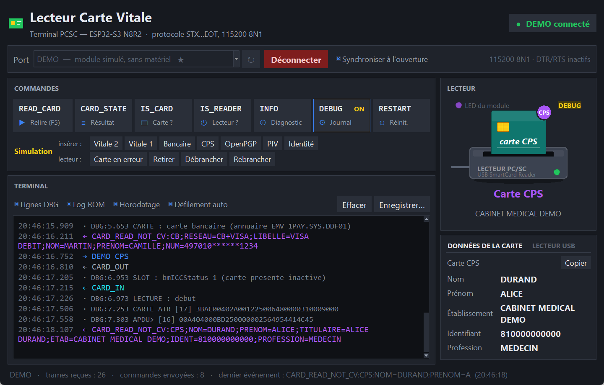
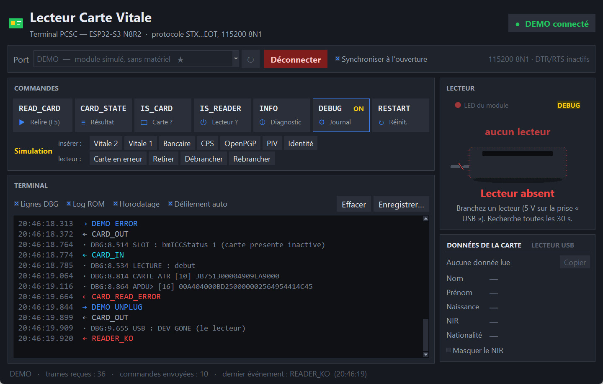

# Terminal `pcsc_term` (interface graphique, exe, ligne de commande)

`tools/pcsc_term.py` regroupe en un seul fichier :
- l'**application graphique** Windows, compilable en `.exe` autonome ;
- un **mode démo** qui simule le module, pour essayer l'interface sans matériel ;
- l'ancien **terminal en ligne de commande**, utile pour les scripts et les
  captures DEBUG.



## Lancer

| Commande | Effet |
|---|---|
| `pcsc_term.exe` | interface graphique (exe autonome, sans Python) |
| `pcsc_term.exe --demo` | interface avec un module **simulé** (données fictives) |
| `python tools\pcsc_term.py` | interface graphique (Python + pyserial) |
| `python tools\pcsc_term.py --demo` | interface avec module simulé |
| `python tools\pcsc_term.py COM12 [commandes…]` | terminal en ligne de commande (voir plus bas) |

L'exe se construit avec `tools\build_exe.bat` (PyInstaller) et sort dans
`tools\dist\pcsc_term.exe`. Il pèse environ 12 Mo et sa propre icône est générée
par le code. `dist\` et `build\` ne sont pas versionnés : on distribue l'exe à part.

Prérequis pour **construire** (pas pour exécuter l'exe) :

```bat
python -m pip install pyserial pyinstaller
```

## La fenêtre

| Zone | Contenu |
|---|---|
| **En-tête** | titre et pastille de connexion (`● COM12 connecté` / `● Déconnecté`) |
| **Barre de port** | liste des ports COM, rafraîchie toutes les 3 s tant qu'on n'est pas connecté |
| **Commandes** | une tuile par commande du protocole : `READ_CARD` (aussi **F5**), `CARD_STATE`, `IS_CARD`, `IS_READER`, `INFO`, `DEBUG` (bascule `DEBUG ON` / `DEBUG OFF`, encadrée et marquée `ON` quand le mode est actif), `RESTART`. Tuiles grisées tant que le port est fermé |
| **Terminal** | toutes les trames, horodatées et colorées par type, avec filtres, enregistrement et saisie libre |
| **Lecteur** (panneau latéral) | dessin animé du lecteur et de la carte, état en clair, LED déduite du module |
| **Données de la carte / Lecteur USB** (onglets) | champs décodés de `CARD_READ`, ou infos de `INFO` |
| **Barre d'état** | port, nombre de trames reçues et de commandes envoyées, dernier événement |

Détails de la barre de port :
- les ponts USB-série sont en tête et marqués `★` (même filtre VID/PID que
  `pcsc_firmware_flash.bat`). L'écran COM3 n'est pas marqué ;
- le dernier port utilisé est présélectionné ;
- `Connecter` ouvre le port en 115200 8N1, **DTR/RTS inactifs**, donc sans reset
  de l'ESP32 ;
- avec **Synchroniser à l'ouverture**, l'application envoie `IS_READER`, `IS_CARD`,
  `CARD_STATE` et `INFO` pour remplir tout de suite le panneau latéral.

Détails du terminal :

| Repère | Type de ligne | Couleur |
|---|---|---|
| `→` | commande envoyée | bleu |
| `←` | trame reçue | vert `READER_OK` / `CARD_READ`, rouge `READER_KO` / `CARD_READ_ERROR`, cyan `CARD_IN`, violet `NOT_CV`… |
| `·` | ligne `DBG:` | gris |
| `~` | log ROM (hors trame) | gris foncé |
| `!` | message de l'application | orange |

- **Filtres instantanés** : `Lignes DBG`, `Log ROM`, `Horodatage`, `Défilement auto`.
- **`Enregistrer…`** écrit tout le journal dans un fichier texte, au format du mode
  ligne de commande (`>>`, `<<`, `~~`, `!!`), filtres non appliqués. `Effacer`
  (Ctrl+L) vide l'affichage.
- **Saisie libre** en bas, façon console : Entrée envoie, flèches ↑ / ↓ parcourent
  l'historique.

## Le panneau « Lecteur »

L'état est **déduit des trames** reçues, comme le fait un hôte du protocole.

| Dessin | État affiché | Trames qui y mènent |
|---|---|---|
| lecteur en pointillés gris | **Port fermé** | — |
| « recherche… », LED bleue qui respire | **Recherche du lecteur…** | `CARD READER v1.0` (démarrage / `RESTART`) |
| lecteur en pointillés rouges, câble coupé | **Lecteur absent** | `READER_KO`, `INFO:READER=NONE` |
| carte fantôme en pointillés + flèche | **Prêt — insérez une carte** | `READER_OK`, `CARD_OUT`, `NO_CARD` |
| carte bleue insérée + anneau qui tourne | **Lecture de la carte…** | `CARD_IN` spontané, ou `READ_CARD` envoyé |
| carte verte « carte Vitale » + ✓ | **Carte Vitale lue** (n bénéficiaires) | `CARD_READ:…` |
| carte brune + ✕ | **Erreur de lecture** | `CARD_READ_ERROR` |
| carte bleu marine « carte bancaire » + `CB` | **Carte bancaire** (réseaux · libellé) | `CARD_READ_NOT_CV:CB;…` |
| carte vert d'eau « carte CPS » + `CPS` | **Carte CPS** (établissement) | `CARD_READ_NOT_CV:CPS;…` |
| carte violette « OpenPGP » + `PGP` / ardoise « carte PIV » + `PIV` | **Carte OpenPGP** / **Carte PIV** | `CARD_READ_NOT_CV:OPENPGP;…` / `:PIV;…` |
| carte sombre « identité » + `ID` | **Document d'identité** (données protégées) | `CARD_READ_NOT_CV:ID` |
| carte grise + `?` (ou verte « Vitale 1 » + `1`) | **Pas une Carte Vitale** (SW) / **Carte Vitale 1** | `CARD_READ_NOT_CV:<SW>` / `:V1` |
| carte bleue sans badge | **Carte insérée** (résultat inconnu) | `CARD_IN` en réponse à `IS_CARD` |

Règles de déduction :
- un `CARD_IN` reçu dans les 2 s qui suivent un `IS_CARD` est une **réponse**
  (carte présente). Seul un `CARD_IN` spontané signale une insertion, donc une
  lecture qui commence ;
- une lecture sans résultat au bout de 20 s repasse en « Carte insérée ».

**LED du module** : la pastille en haut à gauche reproduit la LED WS2812 que le
module devrait afficher dans cet état (voir [materiel.md](materiel.md)).

**DEBUG** : un badge s'affiche quand le module est en mode DEBUG.
- Il apparaît sur `DEBUG_ON`, ou dès qu'une ligne `DBG:` arrive.
- Il disparaît sur `DEBUG_OFF`, ou quand un log ROM signale un redémarrage de l'ESP32.

**Onglet Données de la carte** :
- **Carte Vitale** :
  - Nom, Prénom, Naissance (JJ/MM/AAAA), NIR (groupé `s aa mm dd ccc ooo kk`) et
    Nationalité ;
  - `◀ ▶` passe d'un bénéficiaire à l'autre ;
  - `Masquer le NIR` n'en laisse voir que le début.
- **Autres cartes** : type, puis les champs présents dans la trame (Réseau, Libellé,
  Nom, Prénom, Titulaire, Établissement, Identifiant, Profession, Numéro). Titulaire
  est omis quand Nom et Prénom sont connus.
- `Copier` met les données dans le presse-papiers.

L'**onglet Lecteur USB** reprend la dernière réponse `INFO` (VID:PID, niveau,
`dwFeatures`, ATR, étape, SW, durée). Le bouton `Actualiser (INFO)` la redemande.



## Mode démo (`--demo`)

Le port **`DEMO`** (en tête de liste) est un module **simulé** dans l'application.
Il répond comme le firmware : bannière, `READER_OK`, `IS_*`, `READ_CARD`,
`CARD_STATE`, `INFO`, `DEBUG`, `RESTART`, `UNKNOWN_CMD`. Il envoie aussi un faux
log ROM et quelques lignes `DBG:` en mode DEBUG.

Une rangée **Simulation** joue les gestes physiques :

| Bouton | Commande simulée | Effet |
|---|---|---|
| Vitale 2 | `DEMO VITALE` | carte Vitale à 2 bénéficiaires, **données fictives** |
| Vitale 1 | `DEMO V1` | `NOT_CV:V1` |
| Bancaire | `DEMO BANK` | `NOT_CV:CB;RESEAU=CB+VISA;…;NUM=497010******1234` (fictif) |
| CPS / OpenPGP / PIV / Identité | `DEMO CPS` / `DEMO OPENPGP` / `DEMO PIV` / `DEMO ID` | `NOT_CV:CPS;…` etc. (fictifs) |
| Carte en erreur | `DEMO ERROR` | `CARD_READ_ERROR` |
| Retirer | `DEMO OUT` | retrait de la carte |
| Débrancher | `DEMO UNPLUG` | débranchement du lecteur |
| Rebrancher | `DEMO PLUG` | rebranchement du lecteur |

Les commandes `DEMO …` n'existent pas dans le firmware : envoyées au vrai module,
elles reçoivent `UNKNOWN_CMD`.





## Réglages mémorisés

Fichier `%APPDATA%\pcsc_term\settings.json` : dernier port, taille et position de
la fenêtre, filtres du terminal, synchronisation, masquage du NIR. Le supprimer
remet les valeurs par défaut.

## Mode ligne de commande

Il est activé dès qu'un port est passé en argument. Il sert pour les scripts et
les captures DEBUG longues.

```bat
python S3\pcsc_firmware\tools\pcsc_term.py COMx                      REM interactif
python S3\pcsc_firmware\tools\pcsc_term.py COMx IS_READER IS_CARD INFO
python S3\pcsc_firmware\tools\pcsc_term.py COMx --wait 8 READ_CARD
python S3\pcsc_firmware\tools\pcsc_term.py COMx --listen 300 --log debug.txt "DEBUG ON"
```

- Affichage : `>>` commande envoyée, `<<` trame reçue, `~~` octets hors trame (log ROM).
- `--wait S` : attente après chaque commande (3 s par défaut).
- `--listen N` : rester à l'écoute N secondes après les commandes.
- `--log fichier` : ajouter chaque ligne au fichier.

## Auto-test (développement)

```bat
set PCSC_TERM_SELFTEST=C:\chemin\captures
python S3\pcsc_firmware\tools\pcsc_term.py --demo
```

L'interface déroule seule un scénario et enregistre une capture PNG de sa fenêtre
à chaque état, puis se ferme. Il faut Pillow, mais seulement pour cet auto-test.

- **Avec `--demo`** : port fermé, prêt, lecture, Vitale lue, carte bancaire +
  DEBUG, erreur, lecteur absent, onglet Lecteur USB.
- **Sans `--demo`** : seulement connexion, synchronisation et onglet Lecteur USB,
  sur le port présélectionné. Aucune commande `DEMO` n'est alors envoyée au module.

Les captures de cette page viennent de là.

## Architecture du fichier

| Partie | Rôle |
|---|---|
| `FrameParser`, `open_port`, `encode_cmd`, `list_ports` | noyau commun : tramage STX…EOT, ouverture DTR/RTS inactifs, filtre des ponts USB-série |
| `DemoPort` | module simulé ; mêmes méthodes que `serial.Serial` (`read`, `write`, `cancel_read`, `close`) |
| `run_cli` | mode ligne de commande |
| `run_gui` → `App`, `ReaderState` | interface tkinter (thème sombre fait main, aucune dépendance de plus). `ReaderState` déduit l'état des trames |
| `icon_pixels`, `write_ico` | icône dessinée par le code (fenêtre et `.ico` de l'exe) |

Fils d'exécution :
- un **fil de lecture** lit le port et dépose les trames dans une file ;
- l'interface **dépile cette file toutes les 30 ms** ;
- l'animation (anneau de lecture, LED qui respire) tourne à 20 images/s ;
- un port arraché, par exemple au débranchement de la carte, ferme proprement la
  connexion.
